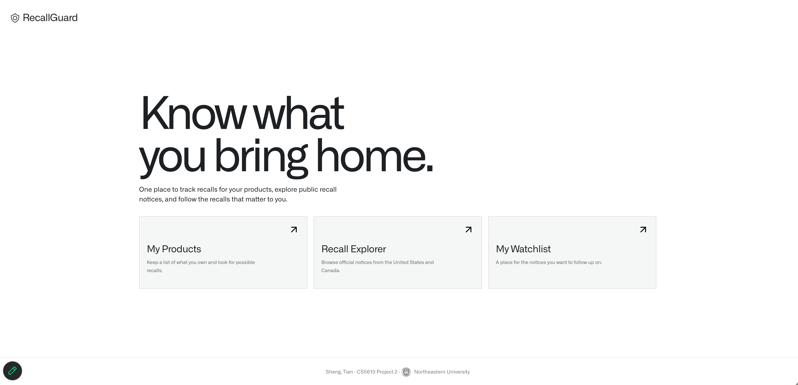
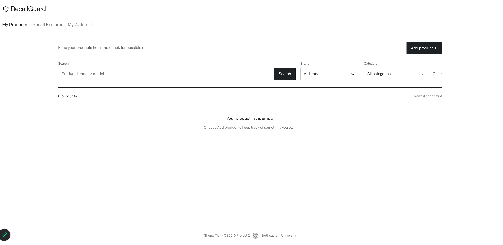
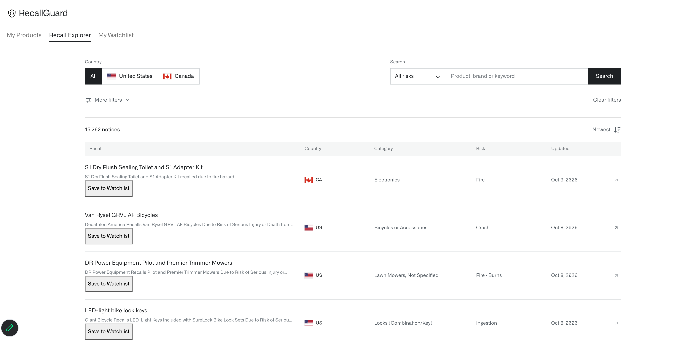
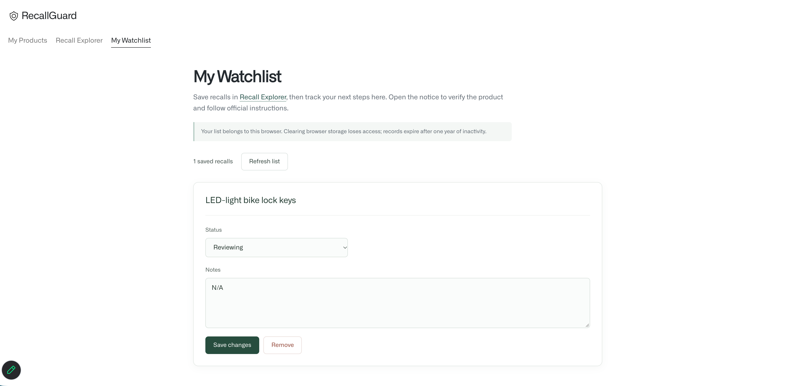

# RecallGuard

Track products you own and check for safety recalls.

**Authors:** Sheng Qin and Tian Yuan  
**Course:** [CS5610 Web Development, Fall 2026](https://johnguerra.co/classes/webDevelopment_online_fall_2026/)  
**Repository:** [GitHub](https://github.com/infiniwire/CS560-P2)  
**Live Website:** [RecallGuard](https://cs560-p2-production.up.railway.app/)

## Project Overview

RecallGuard is a web application that helps users track their products, search government safety recall records, and manage a personal recall watchlist.

The application integrates public recall data from the U.S. Consumer Product Safety Commission (CPSC) and Health Canada, containing over 15,000 recall records.

## Features

### My Products
- Add, edit, and delete personal products.
- Search and filter products by brand and category.
- Find potential recall matches for owned products.

### Recall Explorer
- Browse and search government recall records.
- Filter by country, keyword, category, risk, and date.
- View detailed recall information.

### My Watchlist
- Save important recalls to a personal watchlist.
- Update recall status: Reviewing, Contacted Manufacturer, or Resolved.
- Add and edit personal notes.
- Remove recalls from the watchlist.

## Tech Stack

| Layer | Technologies |
|-------|-------------|
| Frontend | HTML5, CSS3, Vanilla JavaScript (ES6) |
| Backend | Node.js, Express.js |
| Database | MongoDB (Native Driver) |
| Deployment | Railway |
| Data Sources | CPSC, Health Canada |

## Screenshots

### Home Page


### My Products


### Recall Explorer


### My Watchlist


## Installation

**Requirements:** Node.js 22.13+ and npm.

1. Clone the repository:

```bash
git clone https://github.com/infiniwire/CS560-P2.git
cd CS560-P2
```

2. Install dependencies:

```bash
npm ci
```

3. Configure environment variables:

Copy `.env.example` to `.env` and configure the MongoDB connection.

4. Start the application:

```bash
npm run dev
```

5. Open:

http://localhost:4173

To check code quality:

```bash
npm run check
npm run format
```

## Database

RecallGuard uses MongoDB with the native Node.js driver.

Main collections:

- `recalls`: Government recall records (15,262 records).
- `products`: User-owned products.
- `watchlist`: Saved recalls, statuses, and notes.
- `users`: Browser-based user identities.

The application supports CRUD operations on products and watchlist records.

## Documentation

- [Design Document](docs/DESIGN.md)
- [Testing Documentation](docs/TESTING.md)
- [Recall Dataset Documentation](data/README.md)

## Team Responsibilities

**Sheng Qin — My Products & Recall Explorer**
- Product CRUD operations
- Product search and filtering
- Recall matching
- Frontend and backend implementation

**Tian Yuan — Recall Explorer & Watchlist**
- Recall browsing and advanced filtering
- Watchlist CRUD operations
- Status and notes management
- Frontend and backend implementation

Both members contributed to the shared application.

## Deployment

The application is deployed on Railway.

**Live Website:** https://cs560-p2-production.up.railway.app/

Database credentials are stored securely in environment variables and are not committed to GitHub.

## License

This project is licensed under the [MIT License](LICENSE).