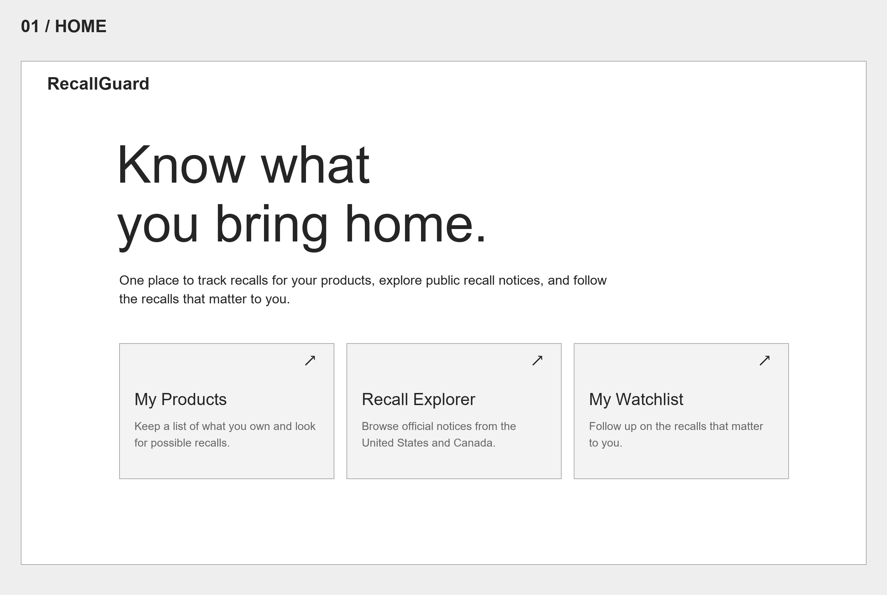
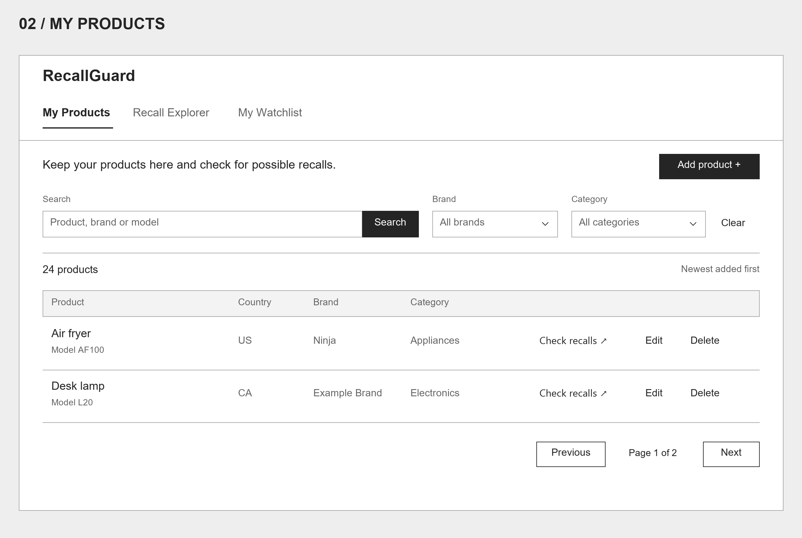
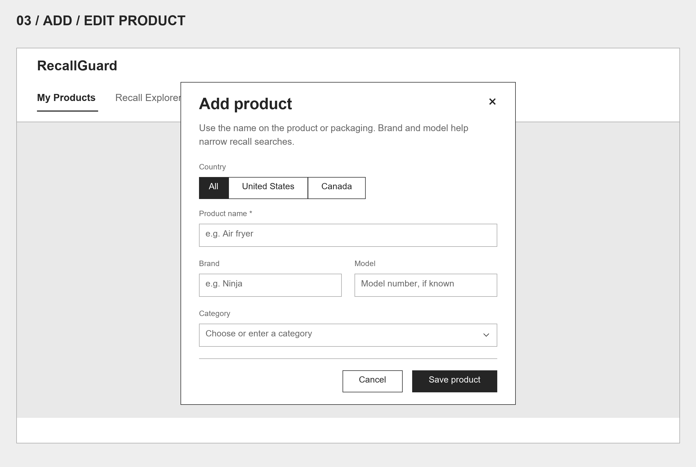
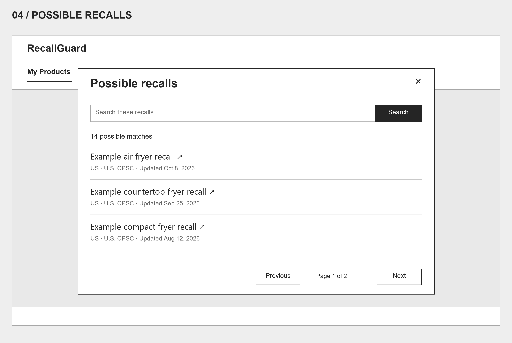
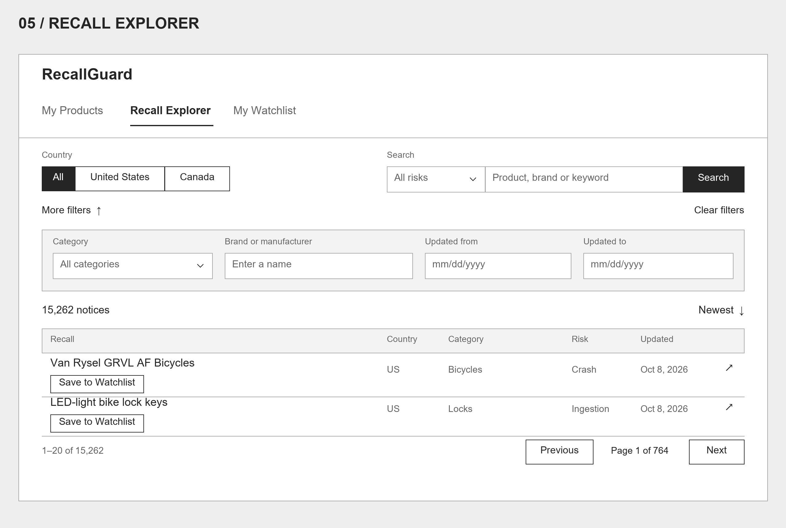
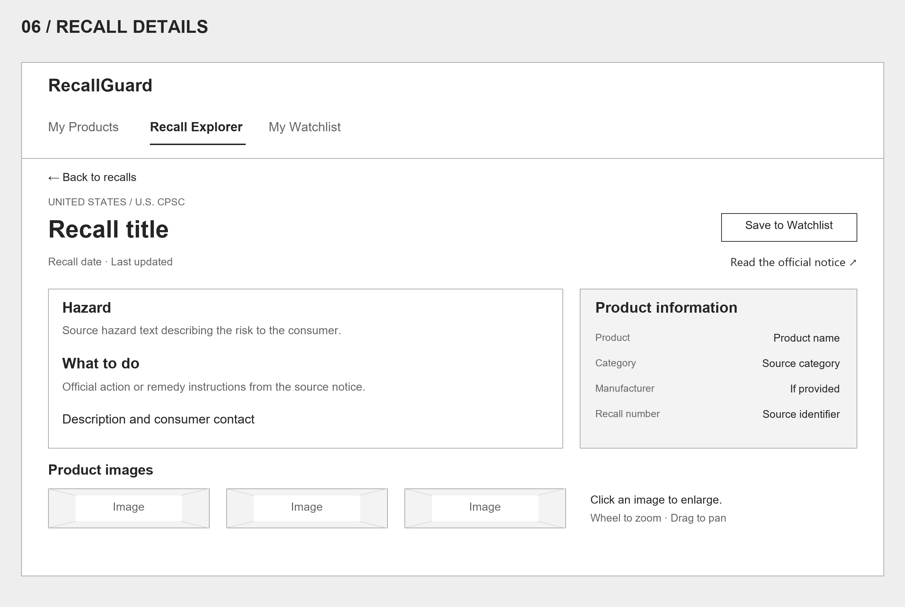
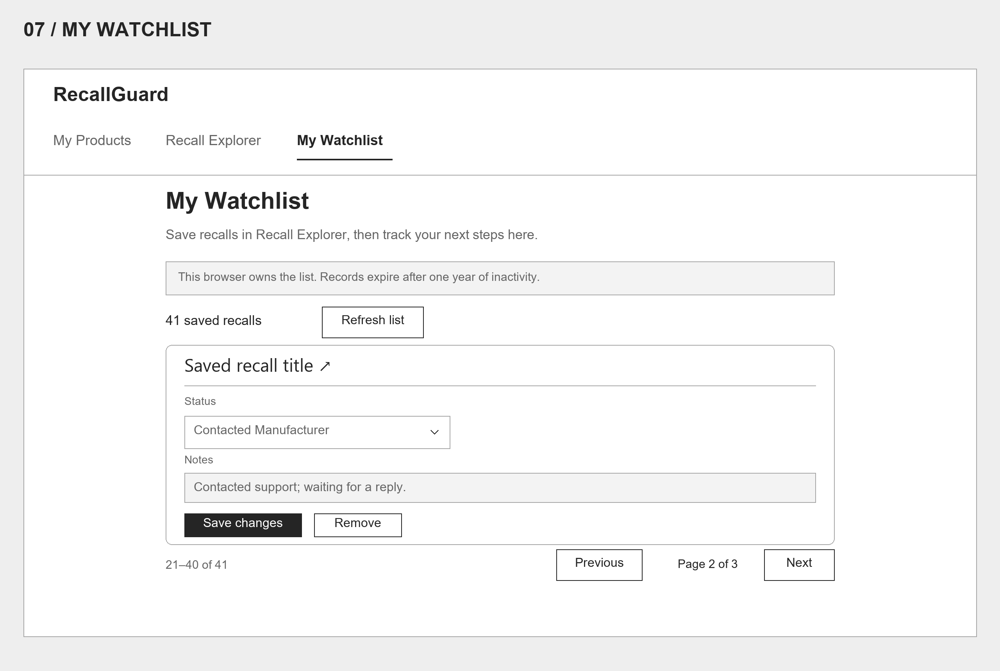
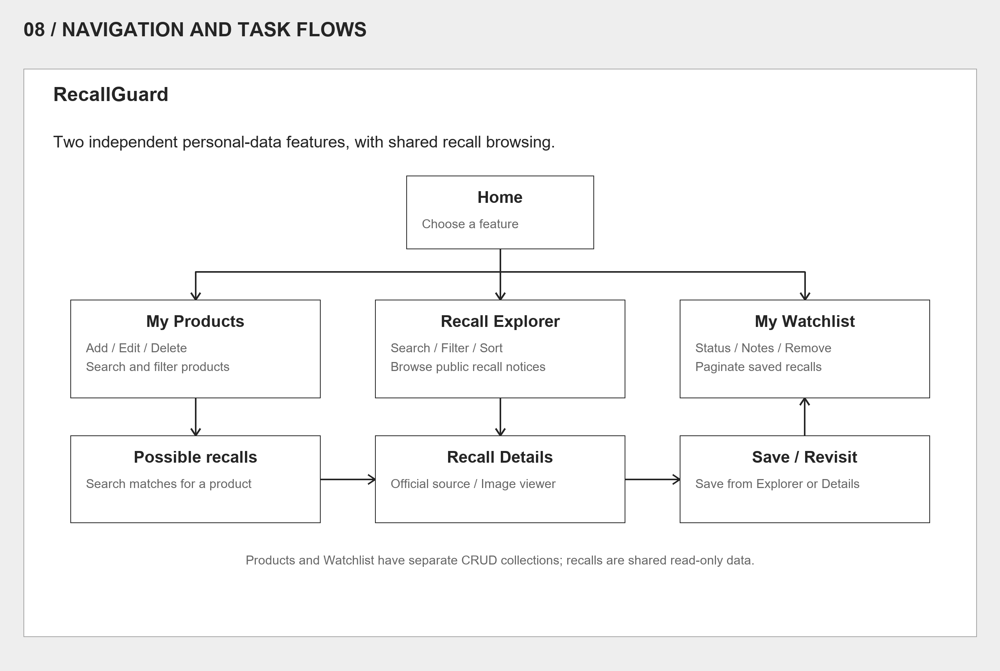

# RecallGuard

## Design Document — Track Products and Check Safety Recalls

**Project:** CS5610 Project 2  
**Team:** Sheng Qin and Tian Yuan  
**Deployed application:** [RecallGuard](https://cs560-p2-production.up.railway.app/)  
**Demo video:** [YouTube](https://youtu.be/re9B-7c_GTQ)  
**Presentation:** [Google Slides](https://docs.google.com/presentation/d/1ufp5M8hFYiZehxvBPbusM1RnFuYfpa3vkGh370FGLbY/edit?usp=sharing)  
**Updated:** October 18, 2026

> This document describes the implemented application and preserves the six user stories from the team's proposal. The wireframes summarize the current interface; they are not original pre-implementation designs.

## 1. Project Description

### Problem and objective

People accumulate electronics and household products over time, while recall information is distributed across government notices. Finding a relevant notice is only part of the task: consumers also need to identify the product, understand the official instructions, and keep track of follow-up actions.

RecallGuard is a web application designed to bring these activities into one place. It combines a personal product tracker with a recall explorer and a saved-recall watchlist. The goal is to help users organize products they own, find possible recall matches, and track relevant notices without repeatedly searching for the same information.

A possible match is a starting point for checking a product, rather than proof that a particular unit is recalled. Users should compare identifying information and follow the linked official notice. The interface itself directs watchlist users to verify the product and follow official instructions.

### Core experience

| Area            | Purpose                                             | Main interactions                                                                                                                        |
| --------------- | --------------------------------------------------- | ---------------------------------------------------------------------------------------------------------------------------------------- |
| Home            | Introduce RecallGuard and offer three entry points. | Open My Products, Recall Explorer, or My Watchlist.                                                                                      |
| My Products     | Maintain an inventory and check possible recalls.   | Add, edit, delete, search, filter, and paginate products; open possible recall matches.                                                  |
| Recall Explorer | Browse shared government recall records.            | Search, combine filters, sort, paginate, open details, and save recalls.                                                                 |
| Recall Details  | Read a notice and reach its official source.        | Review identifying information, hazard and remedy text, save a notice, and zoom or drag product images. Available fields vary by record. |
| My Watchlist    | Track follow-up on saved recalls.                   | Update status and notes, remove entries, and browse 20 entries per page.                                                                 |

### Technology and data design

The frontend uses HTML5, CSS3, Vanilla JavaScript with ES6 modules, and the Fetch API. A single Node.js and Express application serves the static pages and API routes. Database modules use the native MongoDB driver. The application and its MongoDB service are hosted on Railway.

| Collection  | Stored data and operations                                                                                                           | Responsibility           |
| ----------- | ------------------------------------------------------------------------------------------------------------------------------------ | ------------------------ |
| `products`  | Product name, brand, model, category, and country, with browser ownership and timestamps. Supports create, read, update, and delete. | Sheng Qin                |
| `watchlist` | Recall source/ID, a saved title, follow-up status, notes, ownership, and timestamps. Supports create, read, update, and delete.      | Tian Yuan                |
| `recalls`   | Shared, read-only government records using the same fields for U.S. and Canadian notices.                                            | Shared reference dataset |
| `users`     | Browser identity and activity/expiry dates.                                                                                          | Shared infrastructure    |

Each member's feature includes a frontend module, Express routes, and database operations. Product CRUD does not depend on the watchlist, and watchlist CRUD does not depend on products. Both read the shared recall dataset without editing it. The watchlist has a unique index on `(userId, source, sourceId)` so saving the same notice again does not create a duplicate.

The imported dataset contains 15,262 notices: 10,047 from U.S. CPSC and 5,215 from Health Canada. It is a fixed snapshot, not a live feed. Some source fields are missing, and notices from the two countries about the same product remain separate. See [Recall data](../data/README.md) for the schema and source limitations.

### Access and boundaries

No login is required. The browser generates a random UUID and stores it as `recallguard.userId` in localStorage. Requests identify the browser with the `X-User-Id` header. Products and watchlist entries are stored in MongoDB under that ID; the lists themselves are not stored in localStorage.

Clearing browser storage loses access to the previous identity. Its database records remain until they expire or are otherwise removed. Activity renews the identity's active personal records for 365 days. TTL indexes remove expired users, products, and watchlist entries, and application queries exclude expired personal records while deletion is pending.

This is a demo identity mechanism, not secure authentication. Cross-device accounts, email/push alerts, and automatic safety determinations are outside the project scope.

## 2. User Personas

The names and core needs come from the proposal. The scenarios and design implications below elaborate those needs without adding demographic assumptions.

### Norman — Product Owner

**Context:** Norman owns many electronics and household products. He wants one place to keep track of them and quickly check for possible recalls.

**Goals**

- Keep his owned-product list current as he acquires, replaces, or discards products.
- Find a particular product through search, brand, or category.
- Compare possible recall results with the identifying information on his product.

**Pain points:** Product information is scattered across packaging and receipts, and searching government notices separately for every product takes effort. Similar names can make it difficult to distinguish a possible match from the exact affected model.

**Scenario:** Norman records a household appliance using its name, brand, model, and category. Later, he finds it in My Products and checks possible recall matches before comparing the official notice with the product label.

**Design implications:** Keep inventory maintenance separate from browsing all recalls. Use a focused product form, persistent search/filter controls, and clear language about possible matches. The product form explains that brand and model help narrow recall searches.

### Sarah — Safety-Conscious Consumer

**Context:** Sarah regularly checks product recalls. She wants to save important notices and track whether she has taken action.

**Goals**

- Find relevant recalls by product name, brand, category, and risk.
- Keep useful notices available for later review.
- Record follow-up notes and progress, then remove notices she no longer needs to track.

**Pain points:** Repeating searches makes notices hard to revisit, and reading a notice does not capture whether she has contacted a manufacturer or completed a remedy.

**Scenario:** Sarah narrows Recall Explorer to relevant records, opens a notice, and reads the official instructions. She saves the notice, then updates her watchlist notes and status as she takes action.

**Design implications:** Present searchable recall metadata in a scannable table, give notices a dedicated details page, and make saving available near the record. Explain the watchlist's browser-specific access and inactivity expiry before users rely on it.

## 3. User Stories

### Sheng Qin — My Products

#### N1. Maintain owned products

> As Norman, I want to add, edit, and delete products I own so I can keep my product list up to date.

**Intended flow:** Open My Products → add a product → review the inventory → edit inaccurate information or delete an unneeded record.

**Design criteria:** The Add/Edit product dialog contains Country (All, United States, Canada), Product name, Brand, Model, and Category. Only the product name is required. Saving creates or updates the MongoDB record, and deleting removes only the current browser identity's product.

#### N2. Find products

> As Norman, I want to search and filter my products by brand and category so I can find a product easily.

**Intended flow:** Enter a search term and/or select brand/category → inspect the narrowed inventory → clear filters to return to the full list.

**Design criteria:** Keep Search, Brand, Category, and Clear visible together. Search covers name, brand, model, and category; dropdowns filter by exact brand/category. The list shows a total count and 20 products per page, newest added first. Empty results explain the next step.

#### N3. Check possible recall matches

> As Norman, I want to check my products against government recall records so I can see possible recall matches.

**Intended flow:** Locate an owned product → request possible recall matches → inspect relevant notices → verify identifying details against the official source.

**Design criteria:** Use product-name keywords as the main query, with country restricting results when selected. Rank records matching the additional brand/model terms before product-name-only results so missing or inaccurate brand data does not hide all possible matches. Brand matching also searches consumer contact text. The Possible recalls dialog includes its own search field and pagination. Results are possible matches, not confirmed affected units; users must compare the official notice with their product.

### Tian Yuan — Recall Watchlist

#### S1. Discover relevant recalls

> As Sarah, I want to browse and search government recall records by product name, brand, category, and risk so I can find recalls relevant to me.

**Intended flow:** Open Recall Explorer → use keyword/risk filters → expand More filters for category and brand/manufacturer → inspect results → open a recall.

**Design criteria:** Keep primary search controls visible and advanced controls behind More filters. The deployed interface additionally offers country and updated-date filters, newest/oldest sorting, and pagination. Risk labels include hazard types such as Fire or Crash; this document does not assume a numeric severity scale.

#### S2. Save recalls

> As Sarah, I want to save recalls to my watchlist so I can review them later.

**Intended flow:** Find a recall in Explorer or Details → choose Save to Watchlist → revisit it in My Watchlist using the same browser.

**Design criteria:** Offer Save to Watchlist in both Explorer and Details. Store the selected recall with an initial Reviewing status and empty notes. Repeated saves return the existing entry for that browser/source pair.

#### S3. Track action and remove saved recalls

> As Sarah, I want to add notes and update the status of a saved recall, such as Reviewing, Contacted Manufacturer, or Resolved, and remove it when I no longer need to track it.

**Intended flow:** Open a saved notice → record notes and update status → revisit progress → remove the saved item when appropriate.

**Design criteria:** Each saved recall has a status selector (Reviewing, Contacted Manufacturer, or Resolved), notes, Save changes, and Remove. Removal requires confirmation. The list uses server-side pagination with 20 entries per page and returns to a valid page after deletion. Changing pages or refreshing the list prompts before discarding unsaved edits. Opening a notice and returning preserves the page number.

## 4. Design Mockups

These wireframes show the page layout and key controls. Gray boxes indicate grouped content or image placeholders. Sample products, notes, and counts illustrate the interface; they are not screenshots of personal records. Each image has an editable SVG version.

### 4.1 Home

[Editable SVG](mockups/01-home.svg)

**Route:** `/`

The home page introduces RecallGuard with the headline “Know what you bring home.” Three large tiles lead to My Products, Recall Explorer, and My Watchlist. The logo and footer match the inner pages, while the tab navigation stays off the home page.

**Stories supported:** Entry point for N1–N3 and S1–S3.

### 4.2 My Products

[Editable SVG](mockups/02-products.svg)

**Route:** `/products.html`

Search, Brand, and Category appear above the product table. Each row shows the product, country, brand, and category, with Check recalls, Edit, and Delete actions. The list uses 20 products per page. When it is empty, a message directs the user to Add product.

**Stories supported:** N1 and N2; Check recalls starts N3.

### 4.3 Add / Edit Product

[Editable SVG](mockups/03-product-form.svg)

**Entry:** Add product or Edit on My Products.

The form opens in a dialog. Product name is required; country, brand, model, and category are optional. Country can be All, United States, or Canada. Editing uses the same form with the existing values filled in. Cancel closes the dialog without saving.

**Story supported:** N1.

### 4.4 Possible Recalls

[Editable SVG](mockups/04-possible-recalls.svg)

**Entry:** Check recalls on a product row.

The dialog lists possible matches for the selected product, with a search field to narrow the results and 10 matches per page. Each result opens Recall Details. Product-name matches remain available when the brand is missing or inaccurate; matches with additional brand/model terms rank first. Users still need to confirm identifying details in the official notice.

**Story supported:** N3.

### 4.5 Recall Explorer

[Editable SVG](mockups/05-explorer.svg)

**Route:** `/recalls.html`

Country controls and the combined risk/search field stay visible. More filters reveals category, brand/manufacturer, and updated-date ranges; the wireframe shows this expanded state. The results table shows Recall, Country, Category, Risk, and Updated, with links to details and Save to Watchlist actions. Newest/Oldest sorting appears beside the total count.

**Stories supported:** S1 and S2.

### 4.6 Recall Details

[Editable SVG](mockups/06-recall-details.svg)

**Route pattern:** `/recall.html?source=cpsc&id=11020&return=`

The page places hazard and remedy information before the longer description and consumer contact details. Product facts appear alongside the notice, and an official-source link lets users verify the record. Clicking a product image opens the larger viewer with wheel zoom, drag, zoom buttons, Reset, and Escape to close. Missing source fields are indicated rather than filled with assumed values.

**Stories supported:** S1 and S2; reviewing identifying information also supports N3.

### 4.7 My Watchlist

[Editable SVG](mockups/07-watchlist.svg)

**Route:** `/watchlist.html`

The browser-access notice explains where the list belongs and when records expire. Each saved recall links to its details and provides Status, Notes, Save changes, and Remove. The list shows 20 entries per page, newest saved first. Remove requires confirmation, and changing pages or refreshing the list prompts before discarding unsaved edits. With no entries, the page links users to Recall Explorer.

**Stories supported:** S2 and S3.

### Navigation and Task Flows

[Editable SVG](mockups/08-task-flows.svg)

Users can maintain products or saved recalls independently. Both workflows read the same government recall records. Opening a notice from My Watchlist and returning restores the page number.

### Interaction and Usability Principles

- **Keep tasks distinct:** My Products organizes possessions; Recall Explorer searches shared records; My Watchlist tracks follow-up.
- **Support scanning:** Tables expose the key fields before users open a full record.
- **Keep optional filters out of the way:** More filters reveals advanced search controls when needed.
- **Guide empty states:** Personal lists explain how to add their first entry.
- **Keep provenance visible:** Recall Details identifies the government source and links to its official notice.
- **Explain access limitations:** Personal lists use the browser's random identity and expire after inactivity.

## 5. Project Materials

- [Demo video](https://youtu.be/re9B-7c_GTQ)
- [Presentation slides](https://docs.google.com/presentation/d/1ufp5M8hFYiZehxvBPbusM1RnFuYfpa3vkGh370FGLbY/edit?usp=sharing)
- [Live application](https://cs560-p2-production.up.railway.app/)
- [Source code](https://github.com/infiniwire/CS560-P2)
- [Recall dataset and field definitions](../data/README.md)

This document was updated on October 18, 2026 to reflect the current source code and interface.

## Document Format

Wireframes are stored in `docs/mockups/`. PNG images are embedded above for viewing on GitHub; the matching SVG files can be opened in a browser or vector editor. Keep both versions together when sharing this document.
